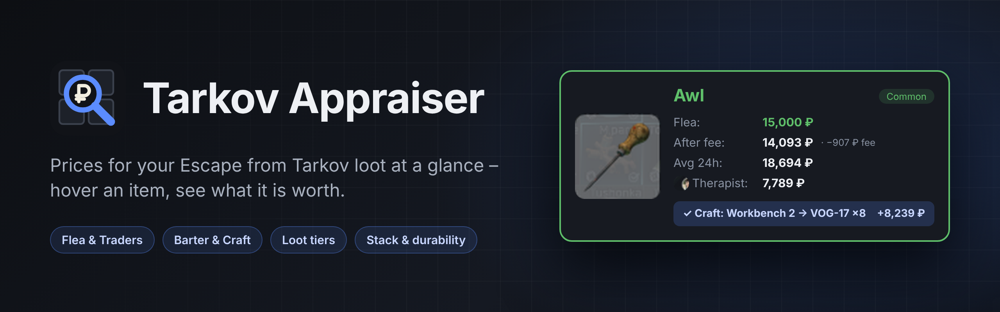
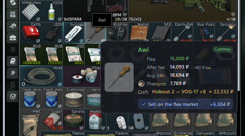
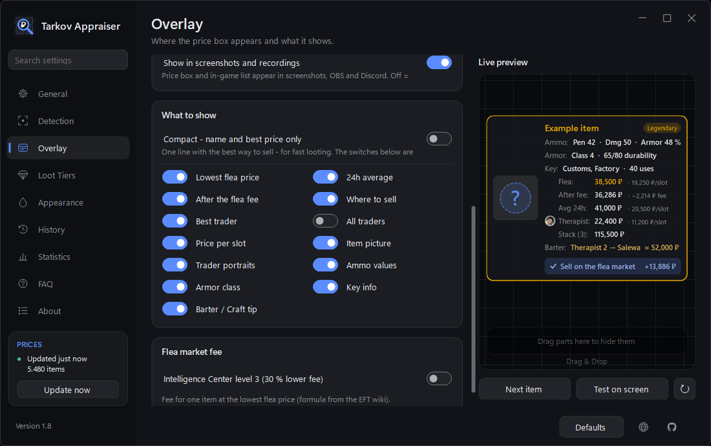

  

  
  
  
  

  <a href="../../releases/latest"><b>⬇ Download</b></a> &nbsp;·&nbsp;
  <a href="#requirements">Requirements</a> &nbsp;·&nbsp;
  <a href="#features">Features</a> &nbsp;·&nbsp;
  <a href="#screenshots">Screenshots</a> &nbsp;·&nbsp;
  <a href="#quick-start">Quick start</a> &nbsp;·&nbsp;
  <a href="#faq">FAQ</a> &nbsp;·&nbsp;
  <a href="#risk-of-use">Risk of use</a> &nbsp;·&nbsp;
  <a href="#legal-notice">Legal notice</a>

**Tarkov Appraiser is a free Escape from Tarkov price checker and flea market price overlay for Windows.**
Hover an item in EFT – it shows what the item is worth, right next to the mouse: flea market price, trader
prices, barters and crafts, and where you get the most for it.
Press **F8**, or switch on the **automatic mode** and you don't even need a key.

🌐 **Website & live demo:** [swear996.github.io/TarkovAppraiser](https://swear996.github.io/TarkovAppraiser/) – hover items, search any item and change the settings right in your browser

## Requirements

| | |
|---|---|
| **Windows** | Windows 10 (version 2004 or newer) or Windows 11, 64-bit |
| **.NET 8** | The [.NET 8 Desktop Runtime](https://dotnet.microsoft.com/download/dotnet/8.0) (or the .NET 8 SDK, which includes it). Without it, Windows offers the download when you start the program. |
| **Text recognition** | The Windows text recognition for your game language (*Windows Settings › Time & Language › Language*). It is usually already there for your Windows language – the welcome window checks it for you. |
| **Game mode** | Tarkov in *Borderless* or *Windowed* mode (not exclusive fullscreen) |
| **Internet** | For the prices from tarkov.dev (saved prices are used when it is offline) |

## Features

### Prices
- **Flea market** – lowest price, 24h average and what you get after the fee
- **Traders** – best sell price with the trader's portrait (or all traders)
- **Where to sell** – flea market, trader, or a barter / craft when trading it in brings clearly more – with how much more you get
- **Price per slot** for big items, **stack value** for exactly what is in the cell

### Read from the game
- **Stack count** – e.g. 18 rounds, read from the cell (or typed in with **Shift+F8** – it is remembered)
- **Armor durability** – the real value of your piece, e.g. `179/190`
- **Key uses** – e.g. `37/40`, plus the map the key is for

### Loot tiers
- Prices colored from **junk to legendary**, valuable loot **framed in its tier color**, junk dimmed
- **Ammo** ranked by how good it is (penetration), while the price keeps the color of what it sells for
- Ammo values: penetration, damage, armor damage · armor class · key maps

### Made for playing
- **Two ways**: hotkey (**F8**) or **automatic mode** – just rest the mouse on an item
- **Arrange the price box** by drag & drop in a live preview; compact mode for fast looting
- **History** of the last 20 items, also as a movable in-game list (**Alt+F8**), with a **raid total**
- **Statistics** – value checked over all raids, best raid, most valuable finds
- Themes and colors, PvP and PvE prices, many game languages, English and German interface
- Any screen resolution, **one-click updates** (asked at startup), FAQ in the settings

## Screenshots

   
  The price box next to the mouse: flea, after fee, 24h average, best trader and a craft tip

   
  Settings with live preview – drag & drop the parts of the price box

## Quick start

1. Download **TarkovAppraiser.exe** from the [latest release](../../releases/latest).
2. Start it. The welcome window walks you through the setup, then Tarkov Appraiser sits in the tray
   (bottom right, next to the clock).
3. In Tarkov: hover an item and press **F8** – or turn on the automatic mode and just hover.

Windows may warn about an unknown app the first time: click *More info* › *Run anyway*.

### Hotkeys

| Key | What it does |
|---|---|
| **F8** | Show the price of the item under the mouse |
| **Ctrl+F8** | Pause / resume the automatic mode |
| **Shift+F8** | Type how many are in a stack, then Enter |
| **Alt+F8** | Show / hide the in-game history list |
| **Esc** | Hide the price box |

All hotkeys can be changed under *Settings › General*.

## FAQ

**The price box does not appear.**
Make sure Tarkov runs in *Borderless* or *Windowed* mode and the item's tooltip is visible.
With the automatic mode: check that it is switched on and not paused (Ctrl+F8).

**It shows the wrong item.**
Check *Settings › Detection › Language* – it has to match the game language.
On unusual screens, set the resolution by hand under *Detection › Resolution*.

**A stack count or durability is wrong.**
Press **Shift+F8** on the stack and type the right number – Tarkov Appraiser remembers how it looks.

**Something else is wrong.**
*Settings › About › Report a problem* prepares a bug report with the log – or [open an issue](../../issues/new/choose).

## How it works

Tarkov Appraiser only looks at your screen, like a screenshot tool: it takes a picture around the mouse,
reads the item name with the text recognition built into Windows and looks up the price.

- **No** reading or writing of the game's memory
- **No** injection, no hooks into the game process, no changed game files
- **No** automated input – it never clicks, moves items or buys / sells for you
- Network: only [tarkov.dev](https://tarkov.dev) (prices and item data) and GitHub (update check)
- Nothing about you or your game is sent anywhere; settings and logs stay on your PC
  (`%AppData%\TarkovAppraiser`)

## Risk of use

> [!WARNING]
> **Use Tarkov Appraiser at your own risk.**
> Escape from Tarkov is protected by an anti-cheat system, and Battlestate Games decides on its own
> which third-party programs it tolerates. Tarkov Appraiser was built to stay on the safe side – it only
> reads the screen and never touches the game – but **nobody can guarantee that using it will never lead
> to a warning, restriction or ban of your account.**
>
> - Read the game's EULA / terms of use yourself and decide whether you want to use such a tool.
> - The authors accept **no liability** for account restrictions, bans, lost items, wrong prices or any
>   other damage resulting from using this program.
> - Prices come from a third party (tarkov.dev) and can be outdated or wrong – check before big trades.

## Legal notice

- Tarkov Appraiser is an independent **fan project**. It is **not affiliated with, endorsed or sponsored by
  Battlestate Games Limited**.
- *Escape from Tarkov* and all related names, logos and item pictures are trademarks or property of
  **Battlestate Games Limited**. They are used here only to describe what the program works with.
- Price and item data, and the item pictures shown in the program, are provided by
  [tarkov.dev](https://tarkov.dev) and remain the property of their respective owners.
- The software is provided **"as is", without warranty of any kind**, express or implied, including but not
  limited to fitness for a particular purpose. In no event shall the authors be liable for any claim,
  damages or other liability arising from its use.
- GitHub and the GitHub logo are trademarks of GitHub, Inc.

## Building from source

Needs the [.NET 8 SDK](https://dotnet.microsoft.com/download/dotnet/8.0).

- `build.bat` – builds `dist\TarkovAppraiser.exe` (small version, needs .NET 8) and starts it;
  set `SELF_CONTAINED=true` in it for a big version that runs without .NET installed
- `test.bat` – checks the number recognition (stack counts, durability, key uses) against pictures from the
  game, and the item recognition against recorded tooltips (start the app once first, so the price list is saved)
- New version: see [RELEASING.md](RELEASING.md)
